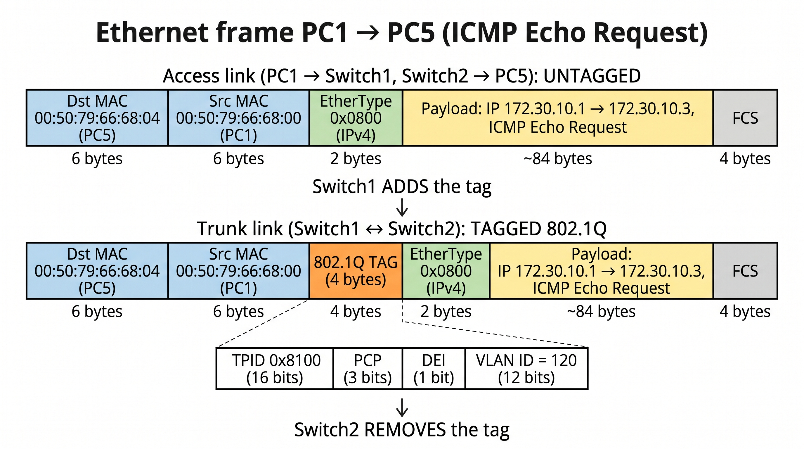

# VLAN, access, trunk și cadrul 802.1Q (teorie)

Notițe teoretice pentru Lucrarea 5 (Administrarea rețelelor).

## 1. Segregarea rețelei

A segrega o rețea înseamnă a o împărți în subrețele izolate. Există 3 metode:

| Metodă | Cum funcționează | Dezavantaje |
|--------|------------------|-------------|
| Adrese IP din clase diferite | Fiecare grup primește alt subnet | Nesigură: adresele IP se pot schimba oricând de pe calculator |
| Rețele separate fizic | Câte un switch pentru fiecare grup | Echipamente în plus, nescalabil |
| **VLAN (IEEE 802.1Q)** | Separare logică pe același switch | Necesită switch care suportă VLAN-uri |

Primele două metode se numesc **flat networking**.

## 2. Ce este un VLAN

**VLAN** (Virtual LAN) = o rețea locală separată **logic**, creată pe un switch fizic. Porturile unui switch sunt împărțite în grupuri, iar un cadru intrat pe un port dintr-un VLAN poate ieși doar pe porturi din **același VLAN**.

Switch-ul se comportă ca mai multe switch-uri virtuale independente, fiecare cu propria tabelă MAC și propriul domeniu de broadcast.

```
Switch1
├── VLAN 120: porturile 0, 1  (PC1, PC2)
└── VLAN 121: porturile 2, 3  (PC3, PC4)
```

Avantaje:
- izolare fără echipamente suplimentare
- scalabil (adaugi VLAN-uri din configurare)
- nu schimbi adresarea IP
- calculatoarele nu știu că există VLAN-uri

Important: două PC-uri pot fi în **același subnet IP** dar în **VLAN-uri diferite**. ARP-ul pleacă, dar switch-ul nu îl transmite între VLAN-uri, deci ping-ul dă `not reachable` (nu "No gateway found").

Gateway-ul e necesar doar pentru ținte din **alt subnet**. Două filtre diferite:
- **IP/subnet (Layer 3)**: decide dacă ai nevoie de gateway
- **VLAN (Layer 2)**: decide dacă switch-ul lasă cadrul să treacă

## 3. Tipuri de porturi

### Port ACCESS
- Port clasic de switch, transmite pachete **UNTAGGED** (fără tag VLAN)
- Aparține unui **singur VLAN**
- Se conectează la el calculatoare, telefoane, imprimante etc.
- Cadrele merg doar între porturile access din același VLAN

### Port TRUNK (dot1q)
- Transportă pachete **TAGGED** din **mai multe VLAN-uri** pe aceeași legătură fizică
- Se folosește de obicei între **switch-uri** (sau switch-router)
- De obicei nu se conectează clienți la el
- În GNS3 se numește **dot1q** (alți producători: 802.1q, trunk etc.)

### Native VLAN
VLAN-ul ale cărui cadre circulă **fără tag** pe trunk (în lucrare: VLAN 1). Trebuie să fie **identic pe ambele capete** ale trunk-ului, altfel apare native VLAN mismatch.

### Tagged vs untagged
- **TAGGED**: cadru care conține tag-ul de VLAN (circulă pe trunk)
- **UNTAGGED**: cadru fără tag (circulă pe porturile access, de la/către calculatoare)

Segregarea se face la nivelul switch-ului, nu al clienților.

## 4. Cum circulă un cadru: ping PC1 -> PC5

Topologie: PC1, PC2 (VLAN 120) și PC3, PC4 (VLAN 121) pe Switch1; PC5 (VLAN 120) și PC6 (VLAN 121) pe Switch2; trunk între switch-uri.

1. PC1 trimite un **ARP broadcast** (fără tag): "cine are 172.30.10.3?"
2. Switch1 îl marchează intern VLAN 120 și îl trimite pe toate porturile din VLAN 120, în afară de cel de intrare: către PC2 (fără tag) și pe trunk (**cu tag 120**). Porturile din VLAN 121 nu primesc nimic.
3. Switch2 primește pe trunk, citește tag-ul, **îl scoate** și trimite doar pe porturile access din VLAN 120 (PC5).
4. PC5 răspunde cu ARP reply (unicast), pe drumul invers.
5. PC1 trimite ICMP echo request, pe același drum.

PC-urile nu văd niciodată tag-ul: el există doar pe legătura dintre switch-uri.

Reguli de comutare:
- **broadcast / destinație necunoscută**: flood pe toate porturile din VLAN, în afară de cel de intrare
- **unicast cunoscut**: doar pe portul unde a fost învățat MAC-ul
- niciodată în afara VLAN-ului; tabela MAC e ținută **per VLAN**

## 5. Schema cadrului (imaginea)



> Salvează imaginea în același folder cu numele `cadru-ethernet.png`.

Imaginea compară același cadru (ICMP Echo Request de la PC1 la PC5) pe două tipuri de legături:

- **Sus: legătura access** (PC1 -> Switch1 și Switch2 -> PC5): cadru **UNTAGGED**
- **Jos: legătura trunk** (Switch1 <-> Switch2): cadru **TAGGED 802.1Q**
- Între ele: **Switch1 adaugă tag-ul**, iar **Switch2 îl scoate**

Singura diferență dintre cele două cadre este tag-ul de 4 bytes. MAC-urile, IP-urile și ICMP-ul rămân identice pe tot drumul.

### Câmpurile cadrului

| Câmp | Mărime | Valoare în exemplu | Ce reprezintă |
|------|--------|--------------------|---------------|
| **Dst MAC** | 6 bytes | `00:50:79:66:68:04` (PC5) | Adresa fizică a destinatarului |
| **Src MAC** | 6 bytes | `00:50:79:66:68:00` (PC1) | Adresa fizică a expeditorului |
| **802.1Q TAG** | 4 bytes | doar pe trunk | Spune switch-ului de la capăt cărui VLAN îi aparține cadrul |
| **EtherType** | 2 bytes | `0x0800` | Codul protocolului din payload (nu e o adresă) |
| **Payload** | ~84 bytes | IP + ICMP | Datele transportate |
| **FCS** | 4 bytes | | Frame Check Sequence: sumă de control pentru detectarea erorilor |

**EtherType** - valori frecvente:

| Valoare | Protocol din payload |
|---------|----------------------|
| `0x0800` | IPv4 |
| `0x0806` | ARP |
| `0x86DD` | IPv6 |
| `0x8100` | tag 802.1Q (urmează un tag VLAN) |

**Payload** = partea utilă a cadrului, pe care Ethernet nu o interpretează. În ping, e un pachet IPv4 care conține un mesaj ICMP:
- 20 bytes header IP + 8 bytes header ICMP + 56 bytes date = 84 bytes
- cu cei 14 bytes de header Ethernet, cadrul apare în Wireshark de **98 bytes**
- payload maxim: **1500 bytes** (MTU)
- la ARP, payload-ul este mesajul ARP, iar EtherType este `0x0806`

Acest lucru se numește **încapsulare**: ICMP e pus în IP, iar IP e pus în Ethernet.

**FCS** se recalculează la adăugarea/scoaterea tag-ului.

### Structura tag-ului 802.1Q (32 de biți)

Tag-ul se inserează **între Src MAC și EtherType**.

| Câmp | Mărime | Ce reprezintă |
|------|--------|---------------|
| **TPID** (Tag Protocol Identifier) | 16 biți | Valoarea `0x8100`. Stă în locul unde ar fi EtherType-ul și anunță că urmează un tag VLAN |
| **PCP** (Priority Code Point) | 3 biți | Prioritatea cadrului (0-7), folosită pentru QoS. În lucrare: 0 |
| **DEI** (Drop Eligible Indicator) | 1 bit | Marchează cadrele care pot fi aruncate primele la congestie (fost CFI). În lucrare: 0 |
| **VLAN ID** (VID) | 12 biți | Numărul VLAN-ului (120 sau 121) |

Detalii:
- 12 biți pentru VLAN ID = 4096 valori; 0 și 4095 sunt rezervate, deci VLAN-uri utilizabile: **1-4094**
- în enunțul lucrării scrie că tag-ul are 12 biți, dar doar **VLAN ID-ul** are 12 biți; tag-ul întreg are 32 de biți (4 bytes)
- cadrul crește cu 4 bytes pe trunk (de la 98 la 102 bytes în exemplu; maximul Ethernet de la 1518 la 1522 bytes)
- doar cadrele din VLAN-uri **non-native** primesc tag; cele din native VLAN circulă fără tag

## 6. QinQ (informativ)

**QinQ** (802.1ad, VLAN stacking) = două tag-uri VLAN pe același cadru: unul exterior (furnizor) peste cel interior (client).

```
Normal 802.1Q:  [Ethernet][tag VLAN 120][date]
QinQ:          [Ethernet][tag exterior][tag VLAN 120][date]
```

În GNS3, câmpul **QinQ EtherType** (`0x8100`, `0x88a8`, `0x9100`) identifică tag-ul exterior. Nu e necesar în lucrare: se lasă `0x8100`, iar porturile folosite sunt doar `access` și `dot1q`.

## 7. Recapitulare rapidă

- **VLAN** = separare logică la Layer 2 pe același switch
- **Access** = fără tag, un singur VLAN, pentru calculatoare
- **Trunk (dot1q)** = cu tag, mai multe VLAN-uri, între switch-uri
- **Tag 802.1Q** = 4 bytes (TPID + PCP + DEI + VLAN ID), între Src MAC și EtherType
- **EtherType** = tipul protocolului din payload, nu o adresă
- **Payload** = pachetul IP (cu ICMP) transportat de cadru
- Același subnet + VLAN-uri diferite = `not reachable`