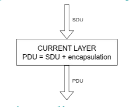
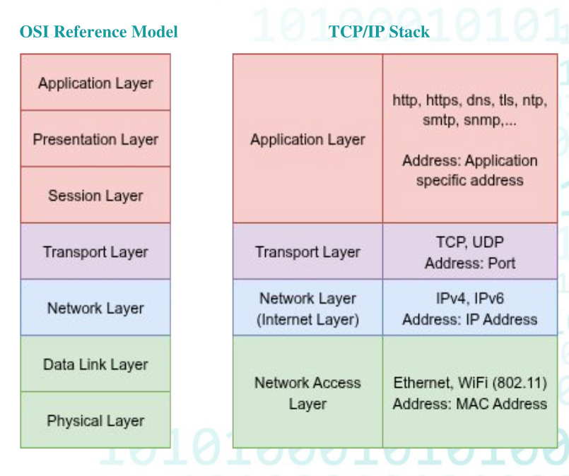

# Stiva OSI

## Modelul OSI

- un model teoretic, care are 7 nivele independente, care comunica prin pachete (date utile + date de incapsulare)
- **SDU** = pachetul primit de nivelul j de la nivelul de sus (j+1).
- **PDU** = pachetul cu încapsulare trimis de nivelul j către nivelul de jos (j−1).

- **Scop:** interoperabilitate între protocoale diferite. Împarte un protocol în sub-protocoale abstracte și independente.
- Nivelul j al nodului i comunică cu nivelul j al nodului k.

- **Istoric (posibile întrebări de memorie):**
	- Studiu lansat în **1977** de ISO împreună cu CCITT (viitorul ITU-T).
	- Definit prima dată de **Hubert Zimmermann**, în **1978**.
	- Arhitectura pe 7 nivele: **Charles Bachman**, Honeywell.
	- Standardizat în **1984**: **ISO 7498** și ITU-T **X.200**.
	- ISO/IEC 7498 are 4 părți: **-1** Basic Model, **-2** Security Architecture, **-3** Naming and Addressing, **-4** Management framework.

---

| Nivel               | Rol din slide                                                                                                                                              | PDU                    | Exemple                           |
| ------------------- | ---------------------------------------------------------------------------------------------------------------------------------------------------------- | ---------------------- | --------------------------------- |
| **L1 Physical**     | Transmite/recepționează date **nestructurate** pe mediu (radio, electric, optic). Specifică tensiuni, viteze, distanțe, modulație, cabluri, conectori etc. | bit, simbol            | SPI, I2C, 802.11, 802.15.4, 802.3 |
| **L2 Data Link**    | Comunicare **stabilă între 2 noduri conectate direct** (node-to-node). Poate face și flow control.                                                         | **frame**              | MAC și LLC din 802.15.4, HDLC     |
| **L3 Network**      | Comunicare între noduri conectate **indirect** sau în **rețele diferite**; rutare, adresă unică per nod.                                                   | **packet**             | IP, ICMP, IPX                     |
| **L4 Transport**    | Legătură sigură între 2 noduri (aceeași rețea sau rețele diferite): segmentare, retransmisii, ack, multiplexare.                                           | **segment, datagramă** | TCP, UDP (din slide 19)           |
| **L5 Session**      | Gestionează **sesiunile** (perioade de schimb continuu de informație) și **autentificarea**.                                                               | date structurate       | RPC, PAP                          |
| **L6 Presentation** | Encodare, serializare, date structurate, **criptare/decriptare**, tipuri de date.                                                                          | –                      | BER                               |
| **L7 Application**  | Aplicația în sine, **nu există reglementare**.                                                                                                             | –                      | http, smtp, ntp, mqtt             |

**Detalii pe care le pot lua la grilă:**

- **L2 are 2 subnivele** (ex. IEEE 802):
    - **MAC** = politici de acces la mediu (CSMA, TDMA).
    - **LLC** = reguli de încapsulare (encodare/decodare frame-uri), detecție și corecție de erori.
    - LLC **poate** (dar nu e obligatoriu) să ofere segmentare, frame sequencing, cereri de retransmisie.
- **L3:** mesajul are minim date + adresă sursă + adresă destinație. Rutarea găsește o cale multi-nod. Segmentarea, detecția/corecția erorilor și retransmisia sunt **opționale**.
- **L4:** modelul definește **5 clase de implementare, TP0–TP4**, pentru că nu toate protocoalele pot implementa toate cerințele. **CONS** = connection-oriented, **CLNS** = connection-less.

---
## Stiva TCP/IP 

- Se numește **Internet Protocol Suite**. Componentele principale: **TCP, UDP, IP**.
- **Nu respectă perfect OSI**: nu implementează toate nivelele direct și individual.

**Network Access Layer** = L1 + L2 din OSI:

- Fizic diferă după mediu: cablu = **Ethernet (IEEE 802.3)**, wireless = **WiFi (IEEE 802.11)**.
- Adresare **MAC pe 6 bytes**.
- Oferă o interfață comună către nivelul superior (IP).

**Internet Layer** = L3 complet din OSI:

- Adresare prin **IP + netmask**, plus **rutare**.
- Oferă baza pentru TCP/UDP. Mai conține **ICMP, IGMP**.
- **NU** oferă comunicație sigură, **NU** face retransmisii, **NU** asigură ordinea pachetelor.

**Transport Layer:**

- Adresare prin **port** (număr întreg). **PORT + IP = SOCKET**.

|                                | TCP                                                  | UDP                          |
| ------------------------------ | ---------------------------------------------------- | ---------------------------- |
| Tip                            | connection-oriented (TP4 – CONS)                     | connection-less (TP4 – CLNS) |
| Conexiune                      | logică, necesară înainte de date utile, monitorizată | nu există                    |
| Confirmare                     | pentru fiecare pachet                                | nu                           |
| Retransmisie                   | da, pentru pachete pierdute/eronate                  | nu                           |
| Segmentare/asamblare în ordine | da                                                   | nu                           |
| Duplicate                      | le identifică și le elimină                          | nu                           |
| Ordinea                        | respectată                                           | nu e asigurată               |
| Rezultat                       | comunicație **fiabilă**                              | –                            |

⚠️ **Capcane:**

- **IP ≠ fiabil.** Fiabilitatea e la TCP, nu la Internet Layer.
- **TCP = CONS, UDP = CLNS**, ambele sub TP4.
- **Network Access îmbină L1 + L2** (nu doar L2).
- Slide-ul 18 are schema cu cele 4 nivele ca imagine, iar textul extras nu include nivelul de aplicație. Uită-te în PDF la schemă și vezi cum e desenat acolo.