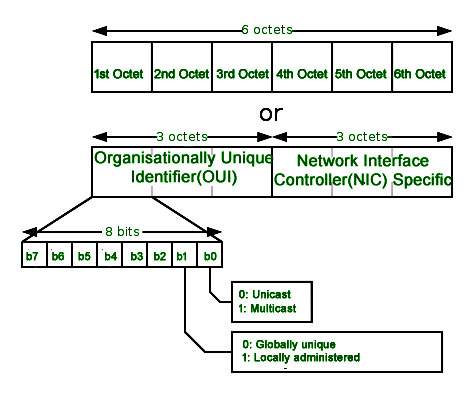
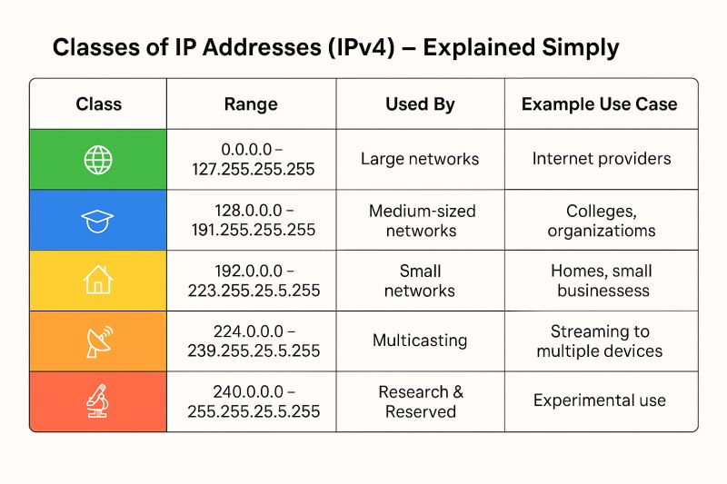

# Adresare MAC

-  este folosita la **L2 OSI = Network Access Layer din TCP/IP**
-  Fiecare echipament din rețea are o adresă MAC, **unică per dispozitiv**.
-  este o adresa hardware, care se poate schimba.
-  pentru identificarea device-urilor din aceeasi retea. Se vede **doar în interiorul rețelei locale**, nu după rutarea L3.
-  **IEEE** gestionează formatul. Cel mai folosit este standardul EUI-48 si mai putin EUI-64.
- **Notație:** fiecare byte pe 2 caractere hex, separat cu `:` sau `-`. Ex. `45:A0:23:98:17:02`. Bytes se numără de la stânga, începând cu **1**.
- **Capacitate:** 2^48 adrese unice, estimat suficient ~100 de ani, până în **2080**. Următorul format: **EUI-64**, cu 2 bytes în plus.

**Structura:**

- **Primii 3 bytes = OUI** (producătorul), asignat de IEEE.
- **Ultimii 3 bytes = NIC** (dispozitivul), gestionat de producător, cu condiția să fie unic.
- **2 biți din primul byte** au sens special, deci ID-ul producătorului are efectiv **22 de biți** (24 − 2).

**Cei doi biți speciali (primul byte):**

| Bit    | Nume                   | Valoare 0                                                                   | Valoare 1                                                                                                                                                                                                                    |
| ------ | ---------------------- | --------------------------------------------------------------------------- | ---------------------------------------------------------------------------------------------------------------------------------------------------------------------------------------------------------------------------- |
| **b0** | I/G (individual/group) | **unicast**: un dispozitiv fizic unic; switch-ul trimite doar pe portul lui | **multicast**: către un grup de adrese cu OUI fix și toate NIC-urile posibile. Este rezervat pentru anumite protocoale.                                                                                                      |
| **b1** | U/L (universal/local)  | **UAA**, administrat global de IEEE, dispozitiv real, unic global           | **LAA**, administrat local sau setat programatic, **nu e garantat unic**; dispozitive virtuale (interfețe de mașini virtuale, interfețe virtuale locale). Practic nu este ceva fizic, este un VM sau un docker spre exemplu. |

- **Exemplu unicast:** `3c:7c:3f:4e:df:89`, cu `3c = 00111100`.

- **Exemplu multicast:** `01:00:5E:00:00:00`, care acoperă intervalul `01:00:5E:00:00:00` – `01:00:5E:7F:FF:FF`. Adresele multicast sunt rezervate unor protocoale.

- **Broadcast:** `FF:FF:FF:FF:FF:FF`. Merge la toate dispozitivele conectate direct la rețea. Cel mai des îl folosește **ARP** sau chiar **DHCP**.

⚠️ **Capcane:**

- **b0 = unicast/multicast, b1 = universal/local.** Se încurcă ușor.
- **Bitul 0 = unicast și universal; bitul 1 = multicast și local.**
- **22 de biți, nu 24**, pentru ID-ul producătorului.
- **MAC-ul NU trece de router.**
- **MAC local = nu e garantat unic**, tipic pentru dispozitive virtuale.
- **OUI = producător, NIC = dispozitiv.** Nu invers.

---

# Adresarea IP

- Lucrează la **L3 OSI** = **Internet Layer** din TCP/IP.
- Ideal pentru identificarea unui device din alta retea.
- Un echipament poate avea **una sau mai multe adrese IP**. Sunt alocate **logic, prin software**, nu pe hardware ca MAC-ul.
- **MAC** adresează dispozitive din aceeași rețea. **IP** adresează logic și dispozitive din **alte rețele interconectate**.
- **IPv4** = 32 biți (4 bytes), **IPv6** = 128 biți.
- **IPv6**  este foarte nesecurizat.
- **Notație:** dot-decimal, un byte per grup. Ex. `192.168.230.123`. Mai rar, hex pe 32 de biți: `192.168.230.123` = `C0A8E67B`.

### **IANA = Internet Assigned Numbers Authority**

- **IANA** gestionează global adresele IP și deleagă la **5 RIR**:
    - **AFRINIC**: Mauritius
    - **ARIN**: Virginia, USA
    - **APNIC**: Brisbane, Australia
    - **LACNIC**: Montevideo, Uruguay
    - **RIPE NCC**: Amsterdam, Netherlands
- **Responsabilități IANA:** adresele IP, numele de domenii (root nameservers din DNS), protocoalele și semnificația porturilor, publicația **RFC**.

### **Biți de rețea și de host**

- **Biți de rețea** = cei mai semnificativi (din stânga). Toate host-urile din aceeași rețea au aceeași valoare pe ei. Identificatorul retelei

- **Biți de host** = cei mai puțin semnificativi (din dreapta). Sunt unici per host.

- **Masca de rețea** face împărțirea dintre ei.

### **Clasele**

| Clasă | Interval                    | Mască implicită | Biți rețea / host      |
| ----- | --------------------------- | --------------- | ---------------------- |
| A     | 0.0.0.0 – 127.255.255.255   | 255.0.0.0       | 8 / 24                 |
| B     | 128.0.0.0 – 191.255.255.255 | 255.255.0.0     | 16 / 16                |
| C     | 192.0.0.0 – 223.255.255.255 | 255.255.255.0   | 24 / 8                 |
| D     | 224.0.0.0 – 239.255.255.255 | nedefinită      | multicast              |
| E     | 240.0.0.0 – 255.255.255.255 | nedefinită      | experimental/cercetare |

### **Intervale rezervate IANA**

|Interval|Rol|
|---|---|
|`0.0.0.0/8`|software, rețele locale în aceeași mașină, nerutabile|
|`10.0.0.0/8`|privat|
|`100.64.0.0/10`|privat în cadrul unui ISP|
|`127.0.0.0/8`|**loopback**, în cadrul aceluiași host, nerutabil nici măcar în afara host-ului|
|`169.254.0.0/16`|nu e o clasă propriu-zisă; adrese asignate automat intern de host când nu se asignează corect o adresă în rețea|
|`172.16.0.0/12`|privat (172.16.0.0 – 172.31.255.255)|
|`192.0.0.0/24`|privat, doar cazuri speciale|
|`192.0.2.0/24`, `198.51.100.0/24`, `203.0.113.0/24`|exemple în documentații|
|`192.88.99.0/24`|interfață cu IPv6, nu se mai folosește|
|`192.168.0.0/16`|privat|
|`198.18.0.0/15`|benchmarking, doar în medii de test controlate|
|`224.0.0.0/4`|clasa D, multicast|
|`240.0.0.0/4`|clasa E, uz viitor/cercetare|
|`255.255.255.255/32`|broadcast local|

### **Private vs publice (slide 36–37)**

- **Private** (LAN, nerutabile pe Internet):
    - `10.0.0.0/8` (clasa A)
    - `172.16.0.0/12` (clasa B)
    - `192.168.0.0/16` (clasa C)
    
- Teoretic poți folosi orice adrese într-un LAN, dar **se recomandă clasele private** definite de IANA. Altfel pot apărea probleme de **rutare**.

- **Publice** = rutabile pe Internet. Nu se recomandă în rețele private (probleme serioase de rutare).

---

⚠️ **Capcane:**

- Slide 34 are o greșeală de tipar la `100.64.0.0/10`: scrie capătul `100.27.255.255`, dar corect e `100.127.255.255`. Reține că /10 pornește de la 100.64.
- **172.16–172.31 sunt private, 172.32 nu.** Același lucru la 172.15.
- **127.x = loopback**, nu 0.x. 0.0.0.0/8 e pentru software local.
- **169.254.x.x** nu e o clasă de IP, ci un interval pentru când adresa nu a fost asignată corect.
- **IANA ≠ IEEE:** IANA gestionează IP-uri, domenii și porturi. IEEE gestionează formatul MAC.
- **Clasa D = multicast**, nu „broadcast”.

--- 

# Subnetting

### **Mască și prefix (slide 31–32)**

- **Subnetting** = împărțirea logică a unei clase de IP în subdiviziuni numite **subnet-uri**.
- **Doar dispozitivele din același subnet comunică direct, fără router.** Sunt în aceeași rețea logică dacă au același **routing prefix**.
- **Masca** = o secvență neîntreruptă de **1** urmată de o secvență neîntreruptă de **0**:
    - 1-urile dau prefixul de rutare.
    - 0-urile dau host identifier-ul.
- **Măști valide:** `255.255.255.0`, `255.255.255.192`.
- **Măști invalide** (din slide): `255.255.255.193` și `255.255.253.0`.
- **Prefix de rețea** = IP **AND** mască.
- **Host** = IP **AND** (NOT mască).
- **Exemplu din slide:** `172.45.30.177/255.255.255.224` → prefix `172.45.30.160`, host `0.0.0.17`.

### **CIDR (slide 33)**

- `/n` = numărul de biți de 1 din mască.
- `255.255.255.0` = `/24`, `255.255.255.224` = `/27`.

### **Număr de host-uri (slide 38)**

- **hostcount = 2^(32−n) − 2.** Se scad adresa de rețea și broadcast-ul.
- **Exemple:** `/8` = 16.777.214, `/16` = 65.534, `/24` = 254.

### **Cazul general (slide 39–40), exemplul `172.25.167.98/19`**

1. **Clasa de bază** = /16 (sau /8). Nu /24, pentru că /19 e mai larg decât /24.
2. **Host-uri per subnet:** 2^(32−19) − 2 = **8190**.
3. **Biți împrumutați:** 19 − 16 = **3**.
4. **Subnet-uri:** 2^(19−16) = **8**.
5. **Salt între subnet-uri:** 8192 / 256 = **32** în al 3-lea octet. Subnet-urile încep la `172.25.0.0`, `172.25.32.0`, `172.25.64.0`, ..., `172.25.224.0`.
6. **Adresa `172.25.167.98`** cade în Subnet 6 (`172.25.160.0` – `172.25.191.255`).

### **Comunicare (slide 41)**

- `172.25.31.200/19` și `172.25.32.200/19` **NU** comunică direct. Prefixele sunt `172.25.0.0` și `172.25.32.0`.

### **Cazuri speciale (slide 42)**

- **/32** = un singur host, fără adresă de rețea și broadcast.
- **/31** = rețea de exact **2 host-uri**, fără rețea/broadcast.
- **Broadcast de subnet** = ajunge doar la host-urile din subnetul respectiv.
- **255.255.255.255** = broadcast pentru toată rețeaua locală, indiferent de subnet.

### Metodă rapidă (e doar aritmetica din slide-uri)

1. Din `/n` află **mărimea blocului** = 2^(32−n), pe octetul unde cade masca.
2. Împarte octetul IP-ului la bloc și ia partea întreagă. Rezultatul × bloc = **adresa de rețea**.
3. **Broadcast** = următorul bloc − 1.

⚠️ **Capcane:**

- Slide 40: la Subnet 7 broadcast-ul e scris `172.25.223.254`, iar corect e **`172.25.223.255`**.
- Slide 41: calculul pentru al doilea IP e scris cu `172.45...`, dar adresa e `172.25.32.200`. Nu te lua după tipar.
- **/31 și /32 nu respectă „−2".**
- **Nu uita „−2" la restul.** Cea mai frecventă greșeală.
- Compară mereu **prefixele**, nu doar IP-urile „apropiate”.