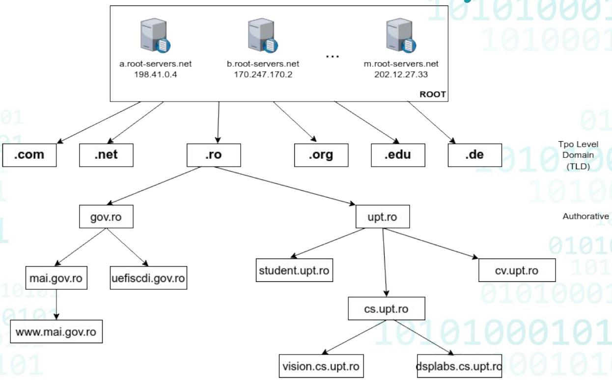
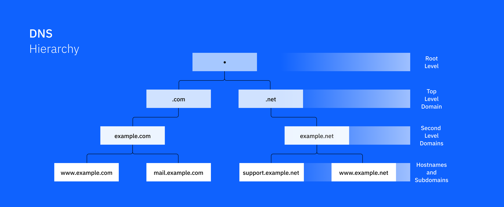
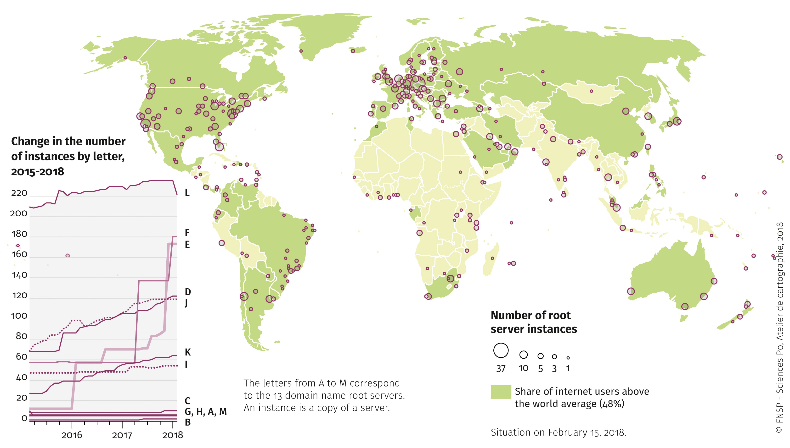
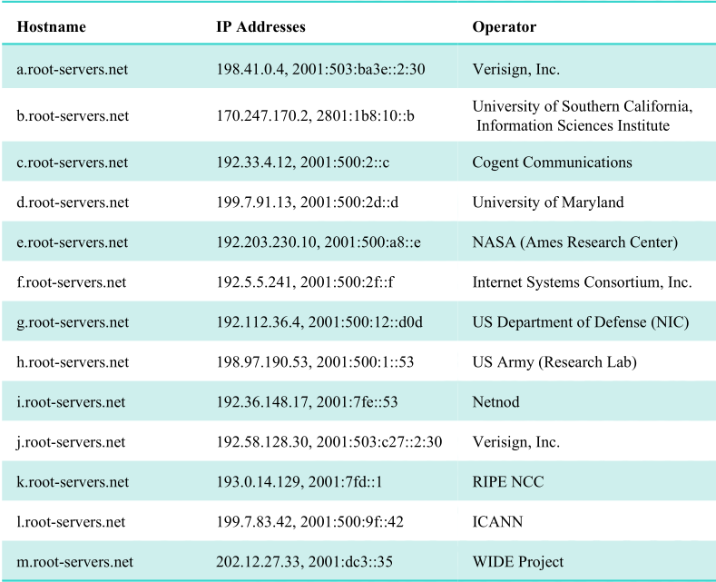
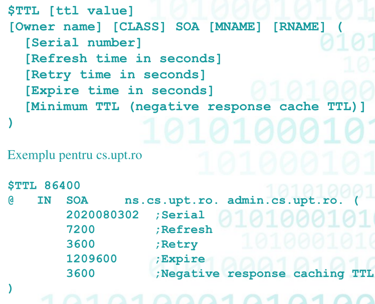
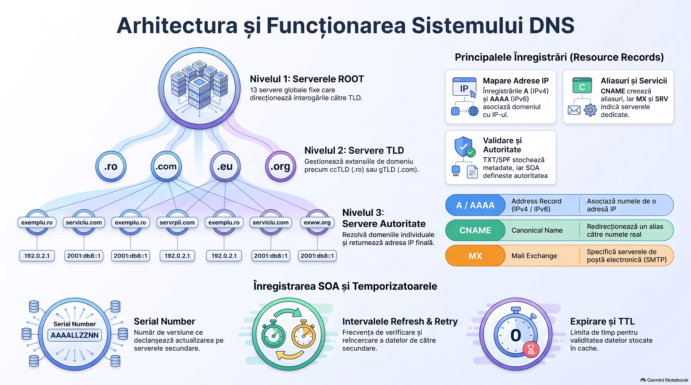

# DNS = Domain Name Systeme

- translatează un nume într-o adresă IP. Bineînțeles poate face și procesul invers, care se numește **Reverse DNS**.

- este un sistem distribuit de server și protocoale care poate gestiona baze de date cu nume de calculatoare, servere sau servicii din Internet.

- fiecare nume poate primi o **adresă IP publică (DNS public)** sau o **adresă IP privată (server DNS privat într-o rețea privată)**.

- **Rolul principal rămâne să rezolve un nume de domeniu într-o adresă IP**.

- Scop: scutește utilizatorul din a mai ține minte sau să memoreze adrese IP.

- Clientul trimite un nume și primește **IP-ul asociat**, pe care apoi îl folosește pentru a accesa serviciul.

- Aplicații server: **bind, CoreDNS, UnboundDNS, PowerDNS, DNS Server (Windows Server)**.

- Folosește **portul 53**, de obicei pe **UDP**, dar funcționează și pe **TCP**.

- Structură ierarhică, arborescentă, pe 3 niveluri:
	- **ROOT**: serverele de bază.
	- **TLDs**: rezolvă ultimul nume de după ultimul punct.
	- **Authoritative**: rezolvă domeniile obișnuite.







---
# ROOT DNS Servers

- **ROL:** **Root** nu rezolvă  domeniul complet, ci doar îți spune care server **TLD** se ocupă de ultima etichetă (de exemplu `.ro`)

- Există **13 servere root** (a–m), fiecare cu **IP fix și nume de domeniu fix** (`a.root-servers.net` … `m.root-servers.net`).

- Fiecare dintre cele 13 e implementat **redundant în mai multe zone geografice** (harta e pe root-servers.org).




- fiecre device care se poate conecta la Internet are **o listă inițială cu serverele root**, inclusă în sistemul de operare.

-  **Root-urile sunt servere nerecursive**

- Operatori (tabelul de pe slide): 
	- a și j = Verisign
	- b = USC-ISI
	- c = Cogent
	- d = Univ. Maryland
	- e = NASA
	- f = ISC
	- g = US DoD
	- h = US Army
	- i = Netnod
	- k = RIPE NCC 
	- l = ICANN
	- m = WIDE Project



---
# TLD Servers

- sunt pe **al doilea nivel după ROOT**. Rezolvă ultimul domeniu de după ultimul punct din URL.

- IP-urile lor sunt introduse în baza de date a serverelor ROOT.

- ROOT rezolvă doar TLD-ul și deleago restul către ele.

- Categorii:
	- **ccTLD** (country): cod de țară, de obicei 2 litere (.ro, .de, .hu, .ch).
	- **Infrastructure**: `.arpa`, primul domeniu creat, gestionat de IANA.
	- **gTLD** (generic), gestionate de IANA: .com, .org, .net, .edu, .gov, .mil, .top, .xyz, .win...
	- **grTLD** (generic restricted): .name, .biz.
	- **sTLD** (sponsored): .aero, .asia, .coop, .jobs.
	- **tTLD** (test): .test.
	- **Reserved**: pentru rețele interne, teste, aplicații private. **Nu sunt rezolvate de ROOT**: .example, .invalid, .local, .localhost, .onion, .internal, .alt.

- TLD-ul nu rezolvă tot URL-ul. **Deleagă** către serverul de nume (NS) al primului domeniu de după TLD, citind de la dreapta la stânga.

- NS-urile către care deleagă TLD-ul se numesc **servere autorizate (authoritative)**.

---

# DNS Records (RR)

- Pentru fiecare domeniu sau subdomeniu se creează o **zonă** (similar cu o bază de date text) cu Resource Records.

| Record    | Denumire                | Ce face                                                                                                                                                                                 |
| --------- | ----------------------- | --------------------------------------------------------------------------------------------------------------------------------------------------------------------------------------- |
| **NS**    | Name Server             | Definește IP-ul unui server DNS autorizat pentru domeniu/subdomeniu                                                                                                                     |
| **A**     | Address Record          | Definește o adresă IPv4 pentru un host obișnuit                                                                                                                                         |
| **AAAA**  | Address Record          | La fel ca A, dar IPv6                                                                                                                                                                   |
| **CNAME** | Canonical name record   | Definește un alias (alt nume) pentru un record deja definit, de obicei de tip A. Practic îl redenumim.                                                                                  |
| **MX**    | mail exchange record    | Definește o listă de servere de mail pentru subdomeniu/domeniu curent. <br><br>Serverul de mail se referă la un host care rulează cu MTA (Mail Transfer Agent) pe **portul 25 (smtp)**. |
| **SRV**   | Service locator         | Specifică locația (IP) unui serviciu                                                                                                                                                    |
| **TXT**   | Text record             | Informații text generale, pentru aplicații utilizator                                                                                                                                   |
| **SPF**   | Sender Policy Framework | Ca TXT, tot text, folosit în aplicații de mail                                                                                                                                          |
| **SOA**   | State of Authoratity    | Probabil cel mai important record din zonă. Spune că serverul curent e autoritatea pentru zonă                                                                                          |


- Sintaxa SRV: `_service._proto.name. ttl IN SRV priority weight port target`

- Exemplul de pe slide: `_sip._tcp.example.com. 86400 IN SRV 20 0 5060 backupbox.example.com`

- Slide-ul scrie SOA = “State of Authority”.


---

# SOA Record




- **TTL**: perioada în secunde cu care serverul DNS superior (cel care a delegat) își actualizează cache-ul pentru zonă, în mod obișnuit, exceptând erorile.

- **Owner name:** zona. De obicei se scrie `@`, care reprezintă direct numele zonei.

- **Class:** tipul zonei, de obicei `IN` (Internet).

- **MNAME**: serverul NS **primar** al zonei, definit ulterior în zonă.

- **RNAME**: mailul administratorului, scris cu altă sintaxă:
	- **Primul punct** de la stânga la dreapta devine `@`.
	- Dacă vrei punct în partea dinainte de `@`, îl scrii cu escape `\.`
	- `admin@cs.upt.ro` → `admin.cs.upt.ro`
	- `ion.popescu@cs.upt.ro` → `ion\.popescu.cs.upt.ro`

- Exemplu `cs.upt.ro`: `@ IN SOA ns.cs.upt.ro. admin.cs.upt.ro.`, cu valorile 2020080302 (Serial), 7200 (Refresh), 3600 (Retry), 1209600 (Expire), 3600 (Negative response caching TTL).


- **Serial Number**:
    - Se schimbă la fiecare modificare a zonei.
    - Format **AAAALLZZNN**: AAAALLZZ = data modificării (an, lună, zi), NN = număr incrementat la fiecare modificare din aceeași zi.
    - Identifică modificările pe serverul primar (master). Când un **secondary** vede că serialul s-a schimbat, pornește actualizarea zonei prin **zone transfer**.

- **Refresh**: la cât timp (secunde) citesc serverele secundare zona de la primar.

- **Retry**: după cât timp (secunde) reîncearcă secundarele dacă primarul nu răspunde.

- **Expire**: timeout. După această perioadă de inactivitate a primarului, secundarele **nu mai răspund la interogări**.

- **Minimum TTL**: similar cu TTL-ul inițial. TTL-ul final = **minim(TTL, MINIMUM TTL)**.


---

# SOA cu configurație minimă

```
      IN NS    ns.cs.upt.ro.
      IN NS    ns.upt.ro.
      IN NS    ns1.upt.ro
      IN A     193.226.12.8
ns    IN A     193.226.12.13
ns2   IN A     193.226.12.3
web   IN A     193.226.12.8
www   IN CNAME web
webmail IN CNAME www
```

- Zona are 3 NS-uri, un A pentru domeniul însuși (fără nume în față) și A-uri pentru `ns`, `ns2` și `web`.
- `www` e alias pentru `web`, iar `webmail` e alias pentru `www`.


