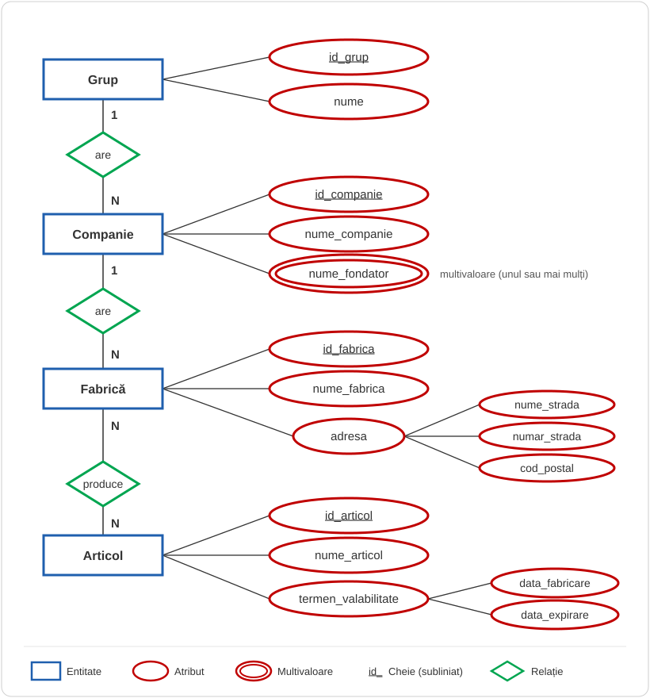
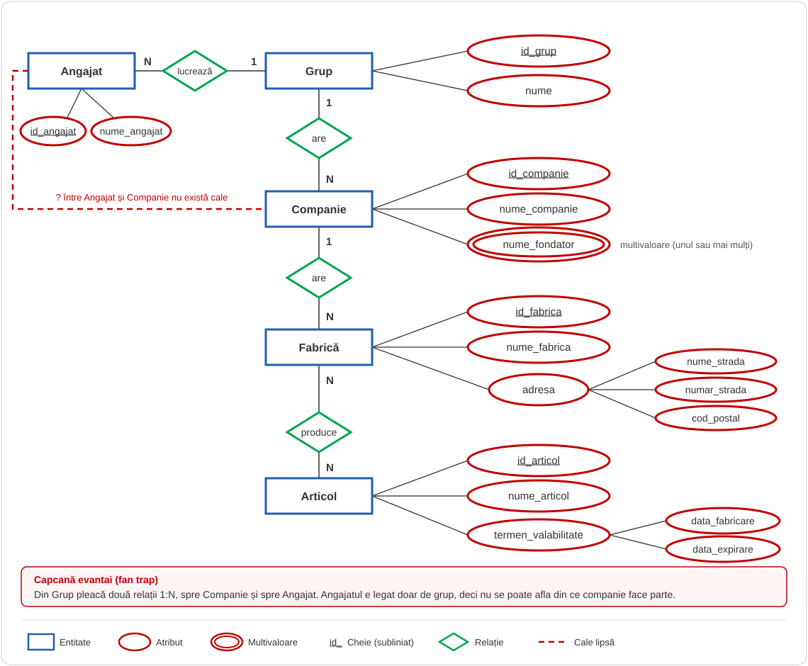
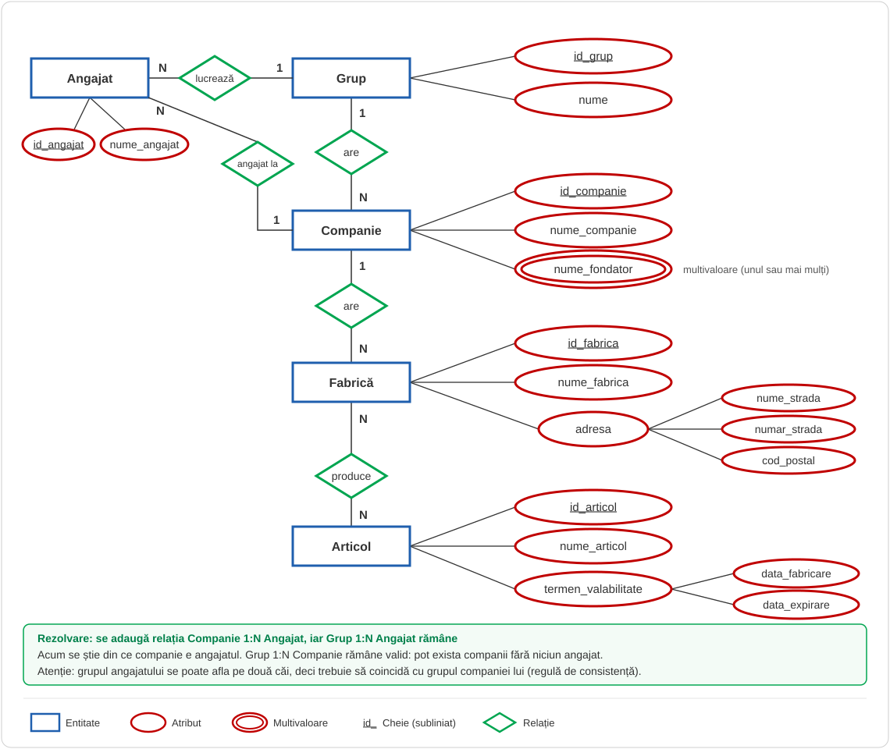

Construiţi o Diagramă Entitate-Realţie cară să modeleze structura ierarhică a unei organizaţii astfel:

·         Un grup este definit printr-un nume şi un id unic. Un grup are mai multe companii, iar o companie aparţine unui singur grup. Orice companie este  definită printr-un id unic al companiei, un nume şi numele fondatorului (unul sau mai mulţi)

·         Fiecare companie are mai multe fabrici, identificare printr-un id al fabricii, un nume şi o adresă care conţine numele străzii, numărul străzii şi codul poştal. Orice fabrică aparţine unei singure companii.

·         O fabrică produce mai multe articole, iar orice articol poate fi produs de mai multe fabrici. Articolul este definit printr-un id unic, un nume, data de fabricare, termen de valabilitate şi data expirării

## Rezolvare

## Adaugare unei capcane.

- Am ales evantai
- Un angajat care lucreaza intr-un grup, dar nu stim din ce companie este?

## Rezolvare capcana

